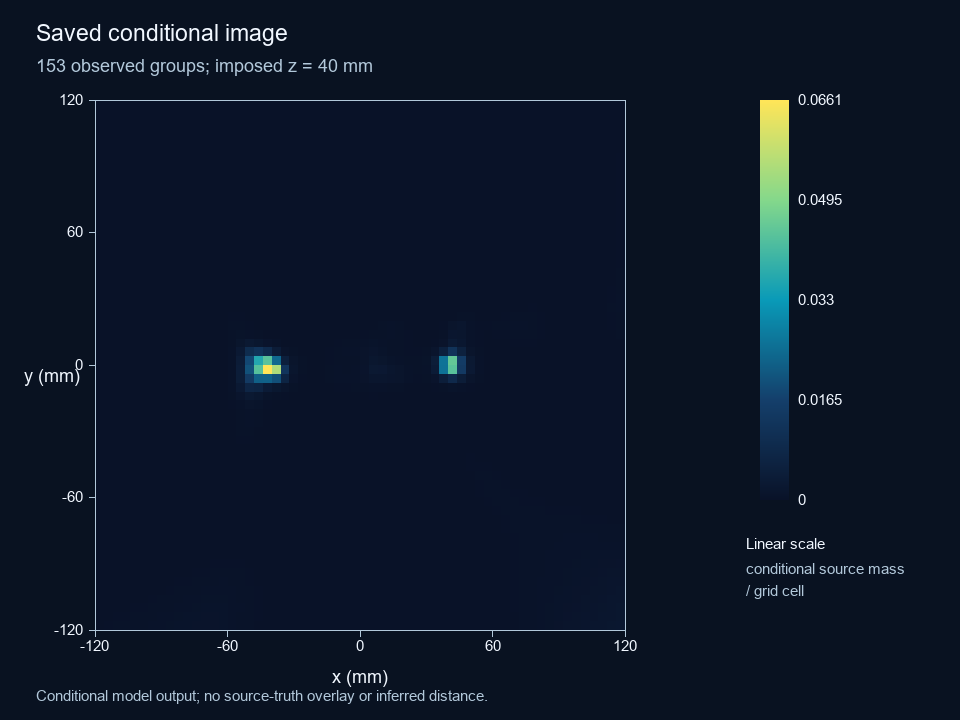

# GeSignal — HPGe Radiation-to-Readout Simulation

Explore how radiation deposits become signed detector signals and an energy
measurement: **Geant4/remage → SolidStateDetectors.jl → preamplifier → analog
shaper → peak ADC**. The website displays saved engineering results; new
simulations run locally.

## Explore a result

- [Follow one signal](https://kunming-cn.github.io/END2END_Ge_Simulation/spectra/pipeline.html) — six saved Cs137 examples with deposits, charge, electronics and original event identities.
- [Browse all studies](https://kunming-cn.github.io/END2END_Ge_Simulation/results/index.html) — four-detector Cs137 10K comparison, two independent 1M-decay cases and GeGI multichannel imaging.
- [Inspect detector models](https://kunming-cn.github.io/END2END_Ge_Simulation/detectors/index.html) and [cryostat assemblies](https://kunming-cn.github.io/END2END_Ge_Simulation/assemblies/index.html).

The [current GeGI study](https://kunming-cn.github.io/END2END_Ge_Simulation/results/gegi-campaign/index.html)
contains 1,000,000 initial records across four independent acquisitions at two
positions. Photon and nuclear-decay denominators remain separate. This is a
conditional reconstruction on an imposed plane: same-energy source separation
remains unresolved, and validated imaging recoveries remain zero.

## Run locally

[Download the student software ZIP](https://github.com/Kunming-CN/END2END_Ge_Simulation/releases/latest/download/END2END-Ge-Student.zip),
extract it and open `tools/site_guide.html`. The maintained
[Windows guide](https://kunming-cn.github.io/END2END_Ge_Simulation/guide.html)
continues from preparation through **Control.cmd**, model/source selection,
**Check environment**, **Check plan**, **Run**, and saved results.

All 17 models can be browsed. Local execution requires a compatible cryostat;
GeGI has its own dedicated assembly. Canonical model inputs, study-specific
operating variants and experimental validation are distinct. Setup was checked
on the existing Windows/WSL computer; fresh-machine portability remains unvalidated.
The student ZIP contains software, models and the guide; saved website studies
are a separate optional download.

## References and contributions

Use [Methods](https://kunming-cn.github.io/END2END_Ge_Simulation/methods/index.html)
for stage definitions, counting rules and scientific limits. The
[maintenance guide](tools/MAINTENANCE.md) records source ownership, while
[PROGRESS.md](PROGRESS.md) is the current development handoff. Historical studies
retain their own identities and do not silently become newer datasets.

[Report a problem or suggest a change](https://github.com/Kunming-CN/END2END_Ge_Simulation/issues),
or read [Contributing](CONTRIBUTING.md). Cite the software with
[CITATION.cff](CITATION.cff). Original software and maintained-source documentation
use the [MIT License](LICENSE); [third-party and data rights](THIRD_PARTY_NOTICES.md)
remain separate.
